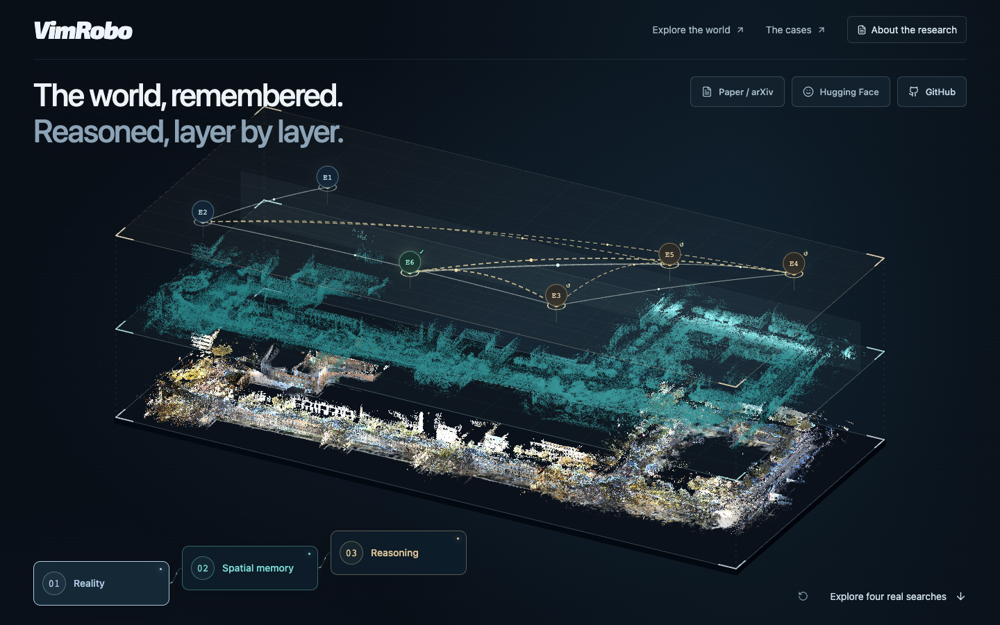

# VimRobo project website

This branch contains **all website source, assets, and prebuilt static files**. The research repository remains on `main`.

- Website: https://atomrecur.github.io/VimRobo/
- Source project: [`website/`](website/)
- GitHub Pages source: **Deploy from a branch → branch-pages → / (root)**

## Develop and publish

Requires Node.js 22.13+ and pnpm 11.25.0.

```sh
git switch branch-pages
cd website
pnpm install --frozen-lockfile
pnpm dev
```

After editing, run `pnpm test` and `pnpm build:pages`. Then commit the source and generated files and push `branch-pages`.

[](https://atomrecur.github.io/VimRobo/)

See [website notes](website/README.md) and [deployment details](website/docs/deployment.md).
