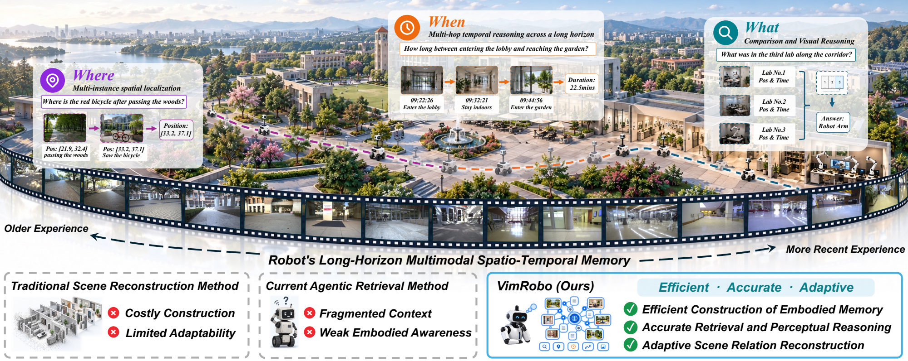
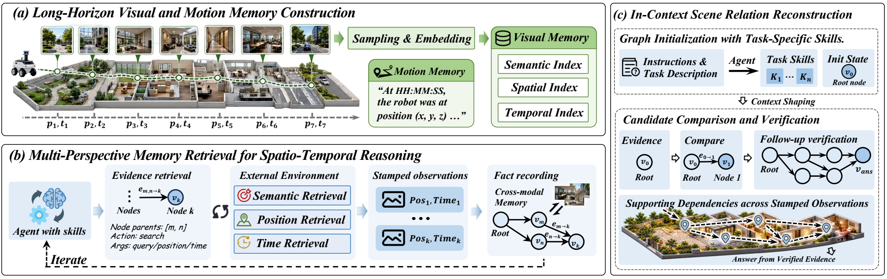

<div align="center">

# VimRobo

**Empowering Spatio-Temporal Reasoning over Long-Horizon Embodied Experience via In-Context Scene Relation Reconstruction**

[](https://atomrecur.github.io/VimRobo/)
[](https://huggingface.co/collections/AtomRecur/vimrobo)
[](https://huggingface.co/AtomRecur/VimRobo-9B)
[](https://huggingface.co/datasets/AtomRecur/RoboMemBench)
[](https://huggingface.co/datasets/AtomRecur/RoboMemExperience)

</div>



## 🔥 News

- **November 2026** — Released the VimRobo memory builder, inference code, and runnable examples.
- **November 2026** — The project website features four recorded search case studies.

## 🔎 Overview

- **Visual and motion memory** links each observation to when and where the robot saw it.
- **Multi-perspective retrieval** finds observations by visual content, position, or time.
- **Evidence graphs** record the observations behind each answer. For each question, the model selects 2–6 skills to guide retrieval and visual checks.

https://github.com/user-attachments/assets/35036f6f-d730-4951-bcf0-6d845967f662

<a id="quick-start"></a>

## 🚀 Quick start

Use Python 3.10+ for the client and a GPU environment with vLLM for the model services. From the repository root, install the client:

```bash
python -m pip install -e .
```



### Build memory

Start the visual embedding service in terminal 1 and leave it running:

```bash
vllm serve Qwen/Qwen3-VL-Embedding-2B --runner pooling --port 8000
```

In terminal 2, index the example recording. Each row of `frames.jsonl` pairs an image with its timestamp and robot position.

```bash
vimrobo-build examples/frames.jsonl outputs/example.npz
```

### Inference

Start the reasoning service in terminal 3. You can also serve a local copy of the checkpoint using `--served-model-name AtomRecur/VimRobo-9B`.

```bash
vllm serve AtomRecur/VimRobo-9B --max-model-len 131072 --port 8001
```

Back in terminal 2, run the example questions and inspect the first answer:

```bash
vimrobo-ask outputs/example.npz --questions examples/query_example.jsonl \
  --model AtomRecur/VimRobo-9B --output outputs/answers.jsonl
head -n 1 outputs/answers.jsonl
```

One example from the 9B evaluation asks “Which furniture items inside the lobby were white in color?” The model returned `{"answer":"white chairs"}`.

To run the full benchmark, download the recordings and both question subsets with the Hugging Face CLI.

```bash
hf download AtomRecur/RoboMemExperience --repo-type dataset --local-dir data/experience
hf download AtomRecur/RoboMemBench --repo-type dataset --local-dir data/benchmark
```

Extract the images next to the frame manifest and build one index for both subsets.

```bash
python -m zipfile -e data/experience/images.zip data/experience
vimrobo-build data/experience/frames.jsonl outputs/experience.npz
```

Run each subset against that index. The two answer files follow the input question order.

```bash
vimrobo-ask outputs/experience.npz --questions data/benchmark/navqa.jsonl \
  --model AtomRecur/VimRobo-9B --output outputs/navqa.jsonl
vimrobo-ask outputs/experience.npz --questions data/benchmark/robomembench.json \
  --model AtomRecur/VimRobo-9B --output outputs/robomembench.jsonl
```

## 📚 Citation

```bibtex
@techreport{wang2026vimrobo,
  title       = {{VimRobo}: Empowering Spatio-Temporal Reasoning over Long-Horizon Embodied Experience via In-Context Scene Relation Reconstruction},
  author      = {Wang, Qiuchen and Liu, Shunyu and Zhang, Junjie and Kong, Yilun and Zhang, Zheng and Tao, Dacheng},
  institution = {Nanyang Technological University},
  year        = {2026},
  url         = {https://atomrecur.github.io/VimRobo/}
}
```
