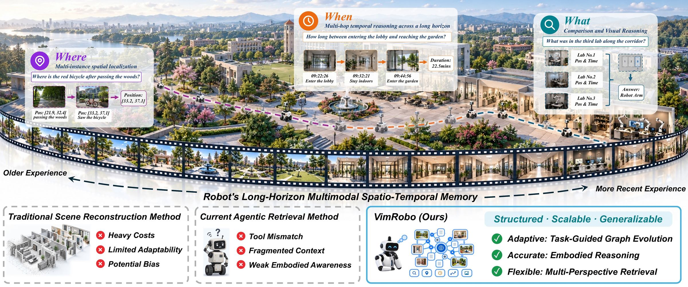

# VimRobo

### Unifying Spatio-Temporal Reasoning over Embodied Experience via In-Context Evidence Integration

**The world, remembered. Reasoned, layer by layer.**

## 🔥 News

- **2026.11** — Interactive project website and four recorded search case studies.
- Paper and Hugging Face links will be added when available.

## 🚀 Overview

**VimRobo** retrieves and reasons over long-horizon embodied experience, integrating visual observations and trajectory context into task-relevant evidence graphs.

- **Visual and motion memory:** connect what a robot sees with where and when it moves.
- **Multi-perspective retrieval:** search under semantic, spatial, and temporal constraints, then inspect and cross-check the evidence.
- **Evolving evidence graphs:** support deep, branching searches that reuse observations and ground answers in retrieved evidence.
